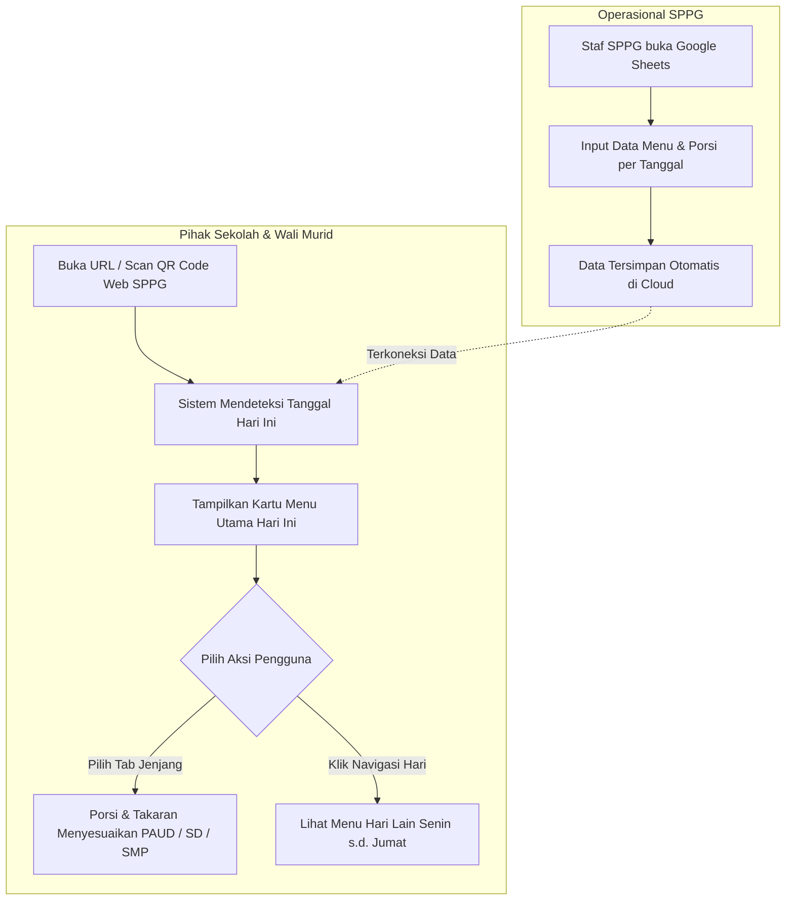

# PRD: Portal Menu Harian MBG SPPG

> **Status Konteks**: Terkunci berdasarkan hasil inisiasi 5W+1H (`IdeaInitiator`)  
> **Batasan Sumber Daya**: Bebas biaya lisensi/database (Rp 0), data dikelola via Google Sheets, arsitektur *lightweight mobile-first web*.

---

## 1. Ringkasan Eksekutif & Tujuan (Executive Summary & Goals)

### Latar Belakang & Masalah (Why)
Program Makan Bergizi Gratis (MBG) dijalankan melalui unit dapur terpusat yaitu **Satuan Pelayanan Pangan Bergizi (SPPG)** yang melayani kluster beberapa sekolah binaan di sekitarnya. Saat ini, koordinasi menu sering kali terhambat karena informasi disampaikan secara manual melalui pesan instan yang sporadis. Akibatnya, pihak sekolah, guru, komite, dan orang tua murid sulit memvalidasi komposisi gizi, jenis hidangan, serta takaran porsi yang seharusnya diterima siswa tiap harinya.

### Solusi & Konsep Inti (What)
Sebuah portal web katalog menu harian (*single page web app*) yang terpusat pada 1 SPPG, bersifat *read-only* bagi publik dan sekolah binaan. Website ini menampilkan:
1. Menu hidangan hari ini (karbohidrat, lauk protein hewani/nabati, sayuran, buah, dan susu).
2. Panduan takaran porsi per jenjang pendidikan (PAUD/TK, SD Kelas Rendah, SD Kelas Tinggi/SMP).
3. Jadwal menu untuk beberapa hari ke depan (tampilan mingguan Senin–Jumat).
4. Pengelolaan data yang praktis menggunakan Google Sheets oleh staf admin SPPG.

### Konteks Operasional (Where & When)
- **Where**: Website publik ringan (*mobile-friendly*), dapat diakses via tautan WhatsApp atau pemindaian QR code di mading sekolah binaan.
- **When**: Diperbarui secara berkala (mingguan atau H-1) oleh SPPG, dan diakses harian oleh pemangku kepentingan sekolah.

### Indikator Keberhasilan (Success Metrics)
- Waktu muat halaman (*first contentful paint*) di bawah 1.5 detik pada koneksi seluler 4G.
- Penginputan jadwal menu mingguan oleh staf SPPG selesai dalam waktu kurang dari 10 menit menggunakan spreadsheet.
- Kemudahan akses: 100% informasi menu dan porsi jenjang dapat diakses tanpa kewajiban registrasi atau login bagi pengunjung.

---

## 2. Target Pengguna (User Personas)

| Peran / Persona | Karakteristik Singkat | Masalah Utama (*Pain Point*) | Tujuan Menggunakan Produk |
| :--- | :--- | :--- | :--- |
| **Admin / Tim Gizi SPPG** | Staf operasional dapur umum SPPG, kemampuan teknis dasar (pengguna Google Sheets/Excel). | Tidak punya waktu mempelajari sistem web rumit; butuh alat input menu yang cepat dan langsung terbit. | Mengunggah jadwal menu harian & panduan porsi satu kali untuk seluruh sekolah binaan. |
| **Pihak Sekolah & Guru** | Kepala sekolah, guru piket MBG, atau panitia penerima makanan di sekolah. | Sering tidak tahu persis menu dan takaran gramasi porsi per anak yang harus diawasi saat distribusi. | Memastikan makanan yang dikirim SPPG sesuai dengan spesifikasi menu dan porsi jenjang muridnya. |
| **Wali Murid & Siswa** | Orang tua yang ingin memantau gizi dan mencegah reaksi alergi pada anak. | Kurang transparansi informasi mengenai variasi makanan yang dikonsumsi anak setiap hari di sekolah. | Mengetahui menu harian anak lebih awal sebelum berangkat sekolah. |

---

## 3. Alur Pengguna (User Flow)

1. **Alur Penginputan (Admin SPPG):** Staf membuka file Google Sheets resmi SPPG → Mengisi baris tanggal, komponen menu (nasi, lauk, sayur, buah, susu), dan takaran porsi per jenjang → Selesai.
2. **Alur Pengaksesan (Pengunjung):** Pihak sekolah/wali murid membuka tautan web → Halaman langsung menampilkan menu hari ini secara default → Pengguna dapat mengklik tab jenjang untuk memfilter takaran porsi, atau menggeser tab hari untuk mengecek menu esok hari.

---

## 4. Prioritas Pengerjaan (MoSCoW Matrix)

| ID | Fitur / Kebutuhan | Kategori MoSCoW | Keterangan & Alasan |
| :--- | :--- | :--- | :--- |
| **FR-01** | Display Menu Hari Ini (Auto-Date) | **Must-Have** | Inti sistem: pengguna langsung melihat menu yang relevan hari ini tanpa navigasi berbelit. |
| **FR-02** | Selektor Porsi per Jenjang (PAUD/SD/SMP) | **Must-Have** | Diferensiasi porsi adalah kebutuhan mendasar operasional MBG di lapangan. |
| **FR-03** | Navigasi Hari (Jadwal Menu Pekan Ini) | **Must-Have** | Memenuhi syarat melihat menu beberapa hari ke depan. |
| **FR-04** | Integrasi Basis Data Google Sheets | **Must-Have** | Menyediakan CMS gratis, cepat, dan mudah dioperasikan staf SPPG. |
| **FR-05** | Tampilan Mobile-First & Responsif | **Must-Have** | Mayoritas pengunjung mengakses dari smartphone/grup WhatsApp. |
| **FR-06** | Status Status Dapur / Keterangan Operasional | **Should-Have** | Menampilkan info kontak SPPG & catatan umum (misal: "Disajikan hangat"). |
| **FR-07** | Indikator Hari Libur / Menu Belum Dirilis | **Should-Have** | Pesan penjelas jika hari libur atau data belum diinput agar tidak membingungkan. |
| **FR-08** | Tombol Salin Teks Menu ke WhatsApp | **Could-Have** | Memudahkan guru membagikan teks ringkasan menu ke chat grup wali murid. |
| **FR-09** | Panel Admin Khusus (Login Form) | **Won't-Have** | Ditunda; staf menginput langsung via Google Sheets native agar efisien. |
| **FR-10** | Sistem Komentar, Rating, atau Pemesanan | **Won't-Have** | Di luar cakupan (*out of scope*) versi MVP. |

---

## 5. Spesifikasi Fungsional (Functional Requirements)

### [FR-01] Display Menu Hari Ini (Auto-Date Detection)
- **Prioritas**: Must-Have
- **Deskripsi Mekanisme**: Saat aplikasi dimuat, sistem membaca tanggal lokal perangkat pengguna. Sistem mencari data baris yang cocok dengan tanggal hari ini dan menampilkan daftar komponen makanan.
- **Komponen Menu yang Ditampilkan**:
  - Makanan Pokok (contoh: Nasi Putih / Nasi Kuning)
  - Lauk Hewani (contoh: Ayam Ungkep Madu)
  - Lauk Nabati (contoh: Tempe Bacem)
  - Sayur (contoh: Sayur Sop Wortel Buncis)
  - Buah (contoh: Pisang Barangan)
  - Minuman / Pelengkap (contoh: Susu UHT 125ml)
- **User Story**: 
  > *"Sebagai wali murid/guru, saya ingin langsung melihat hidangan apa yang disajikan hari ini saat membuka link, tanpa perlu mencari-cari tanggal secara manual."*
- **Acceptance Criteria**:
  - [ ] Sistem menampilkan tanggal lengkap (Hari, Tanggal Bulan Tahun) di bagian atas kartu menu.
  - [ ] Semua komponen makanan yang tersedia pada baris data tanggal tersebut ter-render dengan rapi.

---

### [FR-02] Selektor Panduan Porsi per Jenjang Pendidikan
- **Prioritas**: Must-Have
- **Deskripsi Mekanisme**: Disediakan tombol tab sakelar (*toggle buttons*) untuk memilih jenjang:
  1. `PAUD / TK`
  2. `SD (Kelas 1–3)`
  3. `SD (Kelas 4–6) / SMP`
  Ketika tab ditekan, label takaran porsi (misal berat gramasi nasi, ukuran lauk, dan volume susu) berganti secara dinamis tanpa me-reload halaman.
- **User Story**:
  > *"Sebagai guru SD penerima makanan, saya ingin memilih jenjang kelas murid saya agar dapat memverifikasi apakah porsi nasi dan lauk yang dikirim SPPG sudah sesuai standar usia."*
- **Acceptance Criteria**:
  - [ ] Default jenjang aktif saat pertama kali dibuka adalah salah satu jenjang umum (misal: SD).
  - [ ] Perpindahan tab berlangsung instan (< 100ms) tanpa refresh browser.
  - [ ] Keterangan porsi mencantumkan takaran yang jelas (contoh: Nasi 100 gr vs 150 gr).

---

### [FR-03] Navigasi Jadwal Menu Pekan Ini (Senin – Jumat)
- **Prioritas**: Must-Have
- **Deskripsi Mekanisme**: Halaman menyediakan deretan tombol hari (Senin, Selasa, Rabu, Kamis, Jumat) pada pekan aktif. Pengguna dapat mengeklik hari tertentu untuk meninjau menu yang direncanakan.
- **User Story**:
  > *"Sebagai pihak sekolah, saya ingin melihat menu hari Kamis dan Jumat sejak hari Senin agar dapat mempersiapkan logistik dan mencocokkan pantangan makan siswa alergi."*
- **Acceptance Criteria**:
  - [ ] Tombol hari ini diberi penanda visual khusus (*highlight badge* "Hari Ini").
  - [ ] Mengetuk tombol hari lain langsung memperbarui isi kartu menu sesuai tanggal terpilih.

---

### [FR-04] Skema Sinkronisasi Google Sheets
- **Prioritas**: Must-Have `[Technical Prerequisite]`
- **Deskripsi Mekanisme**: Data disuplai dari Google Spreadsheet yang dikelola SPPG. Web App mengambil data melalui Google Apps Script Web App Endpoint atau Google Sheets Public JSON.
- **Struktur Kolom Database Google Sheets**:
  | Kolom | Nama Field | Tipe Data | Keterangan / Contoh |
  | :--- | :--- | :--- | :--- |
  | A | `Tanggal` | Date (YYYY-MM-DD) | `2026-11-21` |
  | B | `Hari` | String | `Senin` |
  | C | `Makanan_Pokok` | String | `Nasi Putih Gurih` |
  | D | `Lauk_Utama` | String | `Ayam Panggang Semur` |
  | E | `Lauk_Pendamping`| String | `Tahu Tempe Goreng` |
  | F | `Sayuran` | String | `Sayur Capcay Kuah` |
  | G | `Buah` | String | `Jeruk Manis` |
  | H | `Pelengkap` | String | `Susu Putih` |
  | I | `Porsi_PAUD` | String | `Nasi 80g, Ayam 40g, Susu 115ml` |
  | J | `Porsi_SD` | String | `Nasi 120g, Ayam 60g, Susu 125ml` |
  | K | `Porsi_SMP` | String | `Nasi 150g, Ayam 80g, Susu 200ml` |
  | L | `Catatan_Khusus` | String | `Bebas kacang tanah / alergen` |
- **Acceptance Criteria**:
  - [ ] Data yang baru diubah di Google Sheets langsung terrefleksi di web saat halaman di-*refresh*.

---

### [FR-05] Antarmuka Ringan, Responsif, & Mobile-First
- **Prioritas**: Must-Have
- **Deskripsi Mekanisme**: Tata letak dioptimalkan untuk layar ponsel (portrait), berdesain bersih, tipografi jelas, dan palet warna yang segar (bernuansa gizi/kesehatan seperti hijau/putih/oranye lembut).
- **Acceptance Criteria**:
  - [ ] Tampilan rapi dan proporsional di layar ponsel ukuran 360px hingga layar desktop.
  - [ ] Ukuran total bundel web (*assets*) di bawah 500 KB agar hemat kuota internet.

---

## 6. Skenario Gagal & Edge Cases (Gap & Error Handling)

| ID | Kondisi / Skenario Tidak Normal | Perilaku Sistem yang Diharapkan |
| :--- | :--- | :--- |
| **EC-01** | Menu hari ini belum diinput oleh staf SPPG di Google Sheets | Tampilkan pesan informatif: *"Menu untuk hari ini sedang dalam persiapan oleh tim dapur SPPG. Silakan cek kembali beberapa saat lagi."* Jangan tampilkan halaman kosong atau pesan error kode mentah. |
| **EC-02** | Pengguna membuka web pada akhir pekan (Sabtu/Minggu) | Sistem menampilkan pemberitahuan: *"Program MBG libur akhir pekan. Menampilkan jadwal menu hari Senin mendatang."* |
| **EC-03** | Kegagalan koneksi internet atau kuota API Sheets terlampaui | Tampilkan kartu *fallback* bertuliskan: *"Gagal memuat jadwal menu. Periksa koneksi internet Anda lalu coba lagi."* dengan tombol *Coba Lagi (Retry)*. |
| **EC-04** | Salah penulisan format tanggal di Google Sheets oleh staf | Sistem mengabaikan baris rusak dan tetap menampilkan baris data valid lainnya, serta menuliskan log peringatan di konsol. |

---

## 7. Batasan Masalah (Out of Scope)

Fitur berikut ditegaskan **TIDAK** disertakan pada rilis versi 1 (MVP) ini guna menjaga kesederhanaan dan ketepatan waktu peluncuran:
- **Autentikasi & Akun Pengguna:** Tidak ada formulir login/pendaftaran bagi sekolah atau pengunjung umum.
- **Transaksi Distribusi:** Tidak ada pencatatan jumlah boks yang diterima per sekolah di web ini.
- **Formulir Rating/Komentar:** Pengunjung tidak dapat mengirimkan review secara langsung di aplikasi web ini pada fase 1.
- **Integrasi API Antar-Sekolah:** Sekolah mengakses langsung link/domain SPPG; tidak disediakan layanan API endpoint khusus untuk sistem eksternal sekolah.

---

## 8. Catatan Kesiapan Eksekusi (Next Steps)

Dokumen ini telah terkunci dan siap dijadikan acuan langsung untuk tahap pemrograman:
- **Rekomendasi Arsitektur Teknis:** 
  - **Opsi A (Paling Mudah & Zero-Server):** Google Apps Script (GAS) Web App (`Code.gs` + `Index.html`) yang langsung terikat (*container-bound*) dengan file Google Sheets SPPG.
  - **Opsi B (Modern Web):** HTML/Tailwind CSS statis yang mengambil data dari Google Sheets API via fetch JSON.
- **Koneksi Skill Pemrograman:** Dokumen PRD ini dapat langsung dieksekusi menggunakan skill **`gas-code`** untuk meng-generate seluruh kode `Code.gs`, `Index.html`, dan generator template sheet `Setup.gs`.
